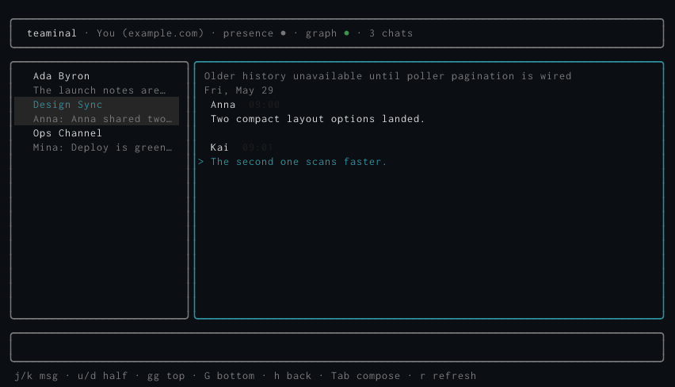
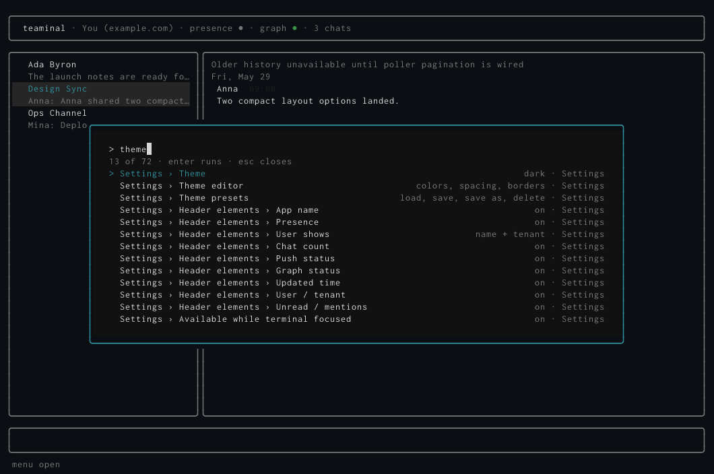

<p align="center"></p>

<h1 align="center">teaminal</h1>

<p align="center">
  <a href="https://github.com/damsleth/teaminal/actions/workflows/ci.yml"></a>
  <a href="https://github.com/damsleth/teaminal/releases"></a>
  <a href="LICENSE"></a>
  <a href="https://bun.sh"></a>
</p>

Lightweight, keyboard-driven terminal Microsoft Teams client. Read your
chats and channels, send messages, manage presence, and skim mentions
without opening the desktop app. Bun + TypeScript + Ink + Microsoft Graph.

Auth is delegated to [`owa-piggy`](https://github.com/damsleth/owa-piggy)
via subprocess - teaminal never sees your refresh token and is not an
Azure AD app registration.

> Status: pre-1.0. The chat surface is solid; channels, presence, and
> notifications are usable; the experimental real-time push transport
> is opt-in. See [CHANGELOG.md](./CHANGELOG.md) for what's shipped.





The screenshots show the seeded offline mode with fixture data. Regenerate
them with `bun run tui:shots` (see [TUI testing](#tui-testing)).

## Install

Homebrew (recommended on macOS):

```bash
brew install damsleth/tap/owa-piggy   # auth broker (one-time setup)
brew install damsleth/tap/teaminal
```

Build from source (any platform with Bun `>= 1.1.0`):

```bash
git clone https://github.com/damsleth/teaminal
cd teaminal
bun install
bun run build
./dist/teaminal
```

Release binaries are attached to each [GitHub Release][releases] for
macOS (arm64 + x64), Linux (x64 + arm64), and Windows (x64).

[releases]: https://github.com/damsleth/teaminal/releases

## Quickstart

```bash
# 1. One-time owa-piggy setup (opens Edge, signs you in, captures a
#    refresh token tied to your existing Outlook web session).
owa-piggy setup --profile work --email you@yourcompany.com

# 2. Verify owa-piggy can mint a Graph token.
owa-piggy token --audience graph >/dev/null

# 3. Launch teaminal.
teaminal --profile work
```

Channel message reads and sends require delegated Graph scopes
`ChannelMessage.Read.All` and `ChannelMessage.Send`. Broader group
scopes such as `Group.ReadWrite.All` do not satisfy those endpoints.

## Platform support

| Platform            | Release artifact suffix |
| ------------------- | ----------------------- |
| macOS Apple Silicon | `darwin-arm64.tar.gz`   |
| macOS Intel         | `darwin-x64.tar.gz`     |
| Linux x64           | `linux-x64.tar.gz`      |
| Linux arm64         | `linux-arm64.tar.gz`    |
| Windows x64         | `windows-x64.zip`       |

## Configuration

teaminal reads JSON settings once at startup from:

```text
${XDG_CONFIG_HOME:-~/.config}/teaminal/config.json
```

All keys are optional. Unknown keys and invalid values produce stderr
warnings and fall back to defaults.

```json
{
  "theme": "dark",
  "accounts": [],
  "activeAccount": null,
  "disabledAccounts": [],
  "chatListShortNames": false,
  "chatListPreviewLines": 1,
  "messagePaneShortNames": true,
  "showPresenceInList": true,
  "showTimestampsInPane": "on",
  "centerDateMarkers": false,
  "showSenderNamesInPane": true,
  "showOwnNameInPane": true,
  "showChatNameHeader": false,
  "messageAvatars": "off",
  "chatListThumbnails": "off",
  "chatListPresenceStyle": "dot",
  "headerBarCentered": false,
  "showReactions": "current",
  "messageFocusIndicatorEnabled": true,
  "messageFocusIndicatorChar": ">",
  "messageFocusIndicatorColor": null,
  "messageFocusBackgroundColor": null,
  "themeOverrides": {},
  "useTeamsPresence": true,
  "forceAvailableWhenFocused": true,
  "realtimeEnabled": false,
  "concurrentAccounts": true,
  "notifyMuted": false,
  "notifyChatMessages": true,
  "notifyActiveBanner": false,
  "quietHoursStart": null,
  "quietHoursEnd": null,
  "logFile": null,
  "tailEvents": false,
  "tailNetwork": false,
  "tailDiagnostics": false,
  "selfMessagesOnRight": false,
  "scrollOnNewMessages": true,
  "enterSends": false,
  "chatListSort": "recent",
  "chatListGroupByType": false,
  "chatListSectionCap": true,
  "inlineImages": "auto",
  "inlineImageMaxRows": 10,
  "statusBarPosition": "bottom",
  "chatRoutingByAccount": {},
  "chatListCollapsedSections": {}
}
```

<!-- prettier-ignore-start -->

| Key                            | Values               | Default | Description                                                                              |
| ------------------------------ | -------------------- | ------: | ---------------------------------------------------------------------------------------- |
| `theme`                        | `auto`, `dark`, `light`, or a custom name | `auto` | Terminal palette + layout preset. `auto` isn't a theme of its own: it picks `light` or `dark` to match the terminal's background color (asked at startup), falling back to the macOS appearance when the terminal doesn't say; a later macOS appearance switch flips it too. Custom names load `~/.config/teaminal/themes/<name>.json` (see [Themes](#themes) below). |
| `accounts`                     | string array         |    `[]` | owa-piggy profile aliases managed by Accounts.                                           |
| `activeAccount`                | string or null       |  `null` | Default profile alias used at startup when `--profile` is not passed.                    |
| `disabledAccounts`             | string array         |    `[]` | Aliases in `accounts` turned off with Space in the Accounts modal. They stay listed (as `off`) with their routing, favorites and caches, but do not start: no polling, push, notifications or presence, and no section in the sidebar. Space turns one on again without a restart. `--profile` still runs a turned-off alias. |
| `chatListShortNames`           | boolean              | `false` | Show first names in chat list rows.                                                      |
| `chatListPreviewLines`         | 0–3                  |     `1` | Last-message preview lines under each chat list row (0 = off). Shorter previews use fewer lines. Replaces `showMessagePreviews` (`false` reads as 0). |
| `messagePaneShortNames`        | boolean              |  `true` | Show first names in the message-pane sender column.                                      |
| `showChatNameHeader`           | boolean              | `false` | Show the conversation name (1:1 partner, group chat, or team · # channel) above the messages. |
| `showPresenceInList`           | boolean              |  `true` | Show presence dots in the chat list when available.                                      |
| `showFavorites` | boolean | `true` | Show the Favorites sections in the chat list. Off lists favorites in their normal sections and keeps them stored. Also in the menu as **Chat list → Show favorites**. |
| `favoritesByAccount` | object | `{}` | Favorites per account, written by `f`: profile alias (`""` for the owa-piggy default profile) → list of `chat:<chatId>` / `channel:<teamId>/<channelId>`. Stored locally only; nothing is written to Teams. |
| `crossAccountFavorites` | object | `{}` | Same shape, written by Ctrl+F: the favorites shown above all accounts when several are open. |
| `showTimestampsInPane` | `off`, `on`, `transient` | `on` | Message timestamps in the message pane. `transient` shows one only when a message comes 15 minutes or more after the previous one. `true` / `false` still read as `on` / `off`. |
| `centerDateMarkers` | boolean | `false` | Center the day separators ("Today", "Fri, May 15") in the message pane. Also in the menu as **Messages → Center dates**. |
| `messageAvatars` | `off`, `small`, `medium`, `large` | `off` | Profile pictures beside other people's messages, 1 / 2 / 3 rows tall, on the first message of each run from the same sender. Needs a terminal with the kitty graphics protocol (kitty, Ghostty, WezTerm) and a Graph account. Also in the menu as **Messages → Profile pictures**. |
| `chatListThumbnails` | `off`, `small`, `medium`, `large` | `off` | Pictures in the chat list, 1 / 2 / 3 rows tall: the other person's photo for 1:1 chats, the team picture for teams and channels. Group and meeting chats show a group / calendar icon at the same size. Without a photo (none set, or no Graph access) the person's initials show. Same terminal and account needs as `messageAvatars`. Also in the menu as **Chat list → Thumbnails**. |
| `chatListPresenceStyle` | `dot`, `badge`, `bar` | `dot` | Where presence shows when thumbnails are on: `dot` beside the name, `badge` as a dot on the picture's bottom-right corner (like Teams), `bar` as a colored strip down the picture's left edge (like Lync). `badge` and `bar` free the dot column for the name. Pictures sent as PNG can't take the mark. Also in the menu as **Chat list → Presence on thumbnails**. |
| `showSenderNamesInPane` | boolean | `true` | Show the sender name above each message. Off leaves only the timestamp (or nothing, with timestamps off); tell senders apart by color. Also in the menu as **Messages → Sender names**. |
| `showOwnNameInPane` | boolean | `true` | Show your name above your own messages. Turn off alongside `selfMessagesOnRight`. Also in the menu as **Messages → My name on my messages**. |
| `showReactions`                | `off`, `current`, `all` | `current` | Show message reactions never, only on the focused message, or on every message.      |
| `messageFocusIndicatorEnabled` | boolean              |  `true` | Show the focused-message marker while navigating messages.                               |
| `messageFocusIndicatorChar`    | single character     |     `>` | Marker shown beside the focused message.                                                 |
| `messageFocusIndicatorColor`   | color or null        |  `null` | Override focused-message marker color.                                                   |
| `messageFocusBackgroundColor`  | color or null        |  `null` | Optional focused-message background color.                                               |
| `themeOverrides`               | object               |    `{}` | Override color roles such as `text`, `mutedText`, `unread`, `timestamp`, `presence`, plus `layout` (paddings), `borders` (border styles for `panel`, `modal`, and the `active` pane, which is drawn in `borderActive`), `emphasis` (per-role bold flags), and `fontSize` (per-element text size in percent, kitty text sizing protocol only). Colors under `dark` / `light` apply only to that base theme (the theme editor writes there); top-level colors apply to every theme. |
| `useTeamsPresence`             | boolean              |  `true` | Use the Teams unified presence endpoint (`presence.teams.microsoft.com`) for own presence. Falls back to Graph `/me/presence` automatically on 401/403/404. Set to `false` to force Graph-only in tenants that block public-client access to that host. |
| `forceAvailableWhenFocused`    | boolean              |  `true` | While the terminal window has focus (DEC focus reporting; CSI ?1004), register a Desktop endpoint with `presence.teams.microsoft.com` and force your picked presence (default Available) so Teams shows you active, like the desktop client does. Refreshed every 4 min; a picked non-Available presence is also held while blurred, and teaminal resets to Available on quit. Set to `false` to leave presence to Teams' own desktop client / inactivity timer. |
| `realtimeEnabled`              | boolean              | `false` | Enables the experimental Teams trouter push transport for typing, read-receipt, presence, and immediate refresh signals. Polling remains the source of truth and fallback. |
| `concurrentAccounts`           | boolean              |  `true` | Run every profile in `accounts` at the same time instead of one at a time (`false` runs one at a time): each keeps polling (and pushing, with `realtimeEnabled`) in the background, and picking an account in the Accounts modal swaps to it instantly, back on the conversation you had open there. With two or more accounts the sidebar lists them all, one section per account in `accounts` order under an account header (`▾ beta 3 @1 · example.com`: chats with unread activity, unread mentions, tenant, and `! signed out` / `! offline` when it needs attention). Opening a row brings its account to the front (the list cursor and filter stay); mark read, delete and the context menu act on the row's account without switching. The pane title, composer, status bar and modals name the account in front, and the Accounts modal shows each account's state. Notifications come from every account and name it (`teaminal · beta · Alice`). A picked presence and the status message apply to every running account. An account whose sign-in expires stops on its own; the others keep running. Read at startup (restart to apply); `--profile` forces single-account mode. Also in the menu as **Settings → All accounts at once**. |
| `notifyMuted`                  | boolean              | `false` | Suppress desktop notification banners while keeping terminal bells.                      |
| `notifyChatMessages`           | boolean              |  `true` | Notify on every new 1:1 / group chat message, not just @mentions. Meeting chats and channels stay mention-only. |
| `notifyActiveBanner`           | boolean              | `false` | Show banners even for the conversation currently open in a focused terminal.             |
| `quietHoursStart`              | `HH:MM` or null      |  `null` | Quiet-hours start time; disabled unless both start and end are set.                      |
| `quietHoursEnd`                | `HH:MM` or null      |  `null` | Quiet-hours end time; windows can cross midnight.                                        |
| `logFile`                      | string or null       |  `null` | Append a redacted event log mirror to this path. CLI `--log-file` overrides it.          |
| `tailEvents`                   | boolean              | `false` | Show an always-on event-log tail panel above the composer.                               |
| `tailNetwork`                  | boolean              | `false` | Show an always-on network-log tail panel above the composer.                             |
| `tailDiagnostics`              | boolean              | `false` | Show an always-on diagnostics tail panel above the composer.                             |
| `selfMessagesOnRight`          | boolean              | `false` | When `true`, your own messages are right-aligned in the message pane (body on the right, sender/timestamp on the left of the body). Other users' messages remain left-aligned. |
| `scrollOnNewMessages`          | boolean              |  `true` | Jump to a new message when it arrives in the open conversation. `false` keeps the cursor where it is. Also in the menu as **Scroll on new messages**. |
| `enterSends` | boolean | `false` | Flip the composer keys: Enter sends, Shift+Enter / Ctrl+Enter / Ctrl+J insert a newline. Only takes effect (and only shown in the menu, as **Enter sends**) in terminals with the kitty keyboard protocol, since elsewhere Shift+Enter is indistinguishable from Enter. |
| `inlineImages`                 | `auto`, `off`        |  `auto` | `auto` renders message images inline in Kitty-compatible terminals, bounded to `inlineImageMaxRows` tall and the width of the message pane, so an image never overlaps neighbouring messages. `off` — and any terminal without Kitty graphics — renders one focusable `[img] name` row per image instead, reserving no picture rows. Space opens the focused image either way. |
| `inlineImageMaxRows`           | integer 1-50         |    `10` | Maximum terminal rows reserved for a single inline image.                                |
| `statusBarPosition`            | `bottom`, `top`, `hidden` | `bottom` | Where the status bar renders: below the composer (`bottom`) or on the top row above the header (`top`). `hidden` suppresses it entirely, freeing one row of vertical space in the message pane. |
| `chatRoutingByAccount`         | object               |    `{}` | Per-account chat transport mode: `graph+ic3`, `ic3+graph`, `ic3-only`, or `graph-only`. |
| `chatListSort`                 | `recent`, `alphabetical` | `recent` | Order of chat rows in the sidebar. `recent` follows last-message time; `alphabetical` sorts by the displayed name. |
| `chatListGroupByType`          | boolean              | `false` | Group sidebar chats under `Direct` / `Groups` / `Meetings` / `Other` headings. Each group shows at most 10 chats, with a `… N more` row to reveal the rest, so one busy type can't push teams and channels off the pane (turn off with `chatListSectionCap`). Headings are collapsible with `h` / `l`. |
| `chatListSectionCap`           | boolean              | `true`  | With grouping on, cap each group at 10 chats behind a `… N more` row. `false` lists every chat. |
| `headerElements`               | object               | all `true` | Per-segment visibility for the header bar. Keys: `app`, `user`, `presence`, `graph`, `chats`, `unread`, `push`, `updated`. Omitted keys keep their default. |
| `headerUserFormat`             | `full`, `tenant`     |  `full` | Header identity format: `full` shows `user (tenant)`, `tenant` shows the tenant only. |
| `statusBarShowKeyHints`        | boolean              |  `true` | Show the keybinding hints line in the status bar. |
| `headerBarCentered`            | boolean              | `false` | Center the header bar segments. Off keeps them left-aligned. |
| `chatListCollapsedSections`    | object               |    `{}` | Collapsed sidebar headers, keyed by section (`oneOnOne`, `group`, `meeting`, `other`, `teams`) or `team:<id>`. Maintained by `h`/`l` in the list (with several accounts open, keys are prefixed with the account: `alpha/team:<id>`, `account:alpha`); a collapsed header hides its rows and shows `▸` plus the hidden count. |
| `chatListWidth`                | integer or null      |  `null` | Explicit chat-list panel width in columns. `null` = automatic (~28% of terminal, clamped 18–60). Adjusted interactively with Ctrl-X resize mode. |
| `composerHeight`               | integer or null      |  `null` | Explicit composer height in rows. `null` = automatic (from draft line count, clamped 3–10). Adjusted interactively with Ctrl-X resize mode. |

<!-- prettier-ignore-end -->

### Themes

The built-in themes are `dark` and `light`, plus `auto`, which picks one
of the two to match the terminal's background. Your own presets are layered
on one of the two (their `base`).

**Presets.** Settings → Theme presets (or `p` in the theme editor) lists
the built-in themes and your saved presets:

| Key           | Action                                                                      |
| ------------- | --------------------------------------------------------------------------- |
| Enter / Space | Load the selected theme.                                                    |
| `s`           | Save the current look into the active preset (a built-in asks for a name).  |
| `n`           | Save as a new preset: type a name, Enter.                                   |
| `d`, then `y` | Delete the selected preset. Deleting the active one falls back to its base. |
| Esc           | Back.                                                                       |

In the theme editor, `s` saves and `S` saves as. Edits made in the editor
(the dots) are unsaved until you save them into a preset, which folds them
into the file and clears them. Loading a preset keeps any unsaved edits on
top, like any other theme switch.

A preset also saves the look-related Settings menu toggles under
`"settings"`: status bar and header options, chat list options (sort,
grouping, short names, preview lines, presence dots) and message options
(chat name header, short names, timestamps, sender names, reactions,
images, right-aligned own messages, focus marker, centered dates), and the
profile pictures and chat list thumbnails sizes. Loading the preset
applies them.

Built-in themes carry none, so switching to one leaves them
as they are. Behavior settings (notifications, presence, scrolling, Enter
sends) are not part of a preset.

Presets are JSON files at `~/.config/teaminal/themes/<name>.json`; you can
also write one by hand and set `"theme": "<name>"` in `config.json`. The
file is a partial theme layered on its `base` (`dark` when absent); any
subset of these keys is accepted:

```jsonc
{
  "base": "light", // built-in palette underneath: "dark" (default) or "light"
  // Color roles (named color or `#rrggbb`):
  "appBackground": "#001100", // whole app; null = terminal background
  "modalBackground": "#002200", // menus / modals; null = terminal background
  "text": "white",
  "border": "#444",
  "borderActive": "magentaBright",
  "selected": "magenta",
  "unread": "yellow",
  "dateMarker": "gray", // day separator ("Today", "Fri, May 15")
  "senderMessage": null, // other people's message text; null = terminal text color
  "senderMessageBackground": null, // background behind other people's messages
  "chatListPreviewText": null, // chat list last-message preview (read chats); null = muted text
  "selfName": "cyan", // your name above your own messages
  "selfMessageBackground": null, // background behind your own messages
  "messageFocusText": null, // focused message text; null = the message's own color
  "messageFocusIndicator": "cyan", // the focus marker
  "messageFocusBackground": null, // focused message background
  "selectedRowBackground": "#262626", // selected chat-list row
  "unreadRow": "yellow", // unread chat names
  "systemEvent": "gray", // "Ada joined the chat" lines
  "errorText": "red", // also warnText, infoText
  // Per-presence colors:
  "presence": { "Available": "greenBright", "DoNotDisturb": "red" },
  // Paddings / margins (non-negative integers):
  "layout": {
    "modalPaddingX": 3,
    "modalPaddingY": 1,
    "paneHeaderPaddingLeft": 1, // message body indent
    "senderIndent": 1, // sender name + timestamp indent
    "paneHeaderMarginBottom": 1, // message gap; 0.5 steps give half-row gaps in kitty
    "chatListIndent": 1, // columns between the presence dot and the chat name
    "chatListGap": 0, // blank rows between chats in the list
    "accountGap": 0, // blank rows between accounts (and the cross-account Favorites) in the list
    "textBackgroundPaddingX": 0, // bg-colored columns around focused / own message bodies
    "textBackgroundPaddingY": 0, // bg-colored rows above / below them
    "textBackgroundRadius": 0, // 1 = rounded "speech bubble" corners on message backgrounds
    "avatarIndent": 0, // columns before the profile picture in conversations
    "senderPinned": 0, // 1 = sender line sits on the message, following the conversation width
    "avatarPinned": 0, // 1 = profile picture sits beside the message, following the conversation width
    "dateMarkerIndent": 0, // extra indent of the day separator ("Today")
    "messageMaxWidth": 100, // conversation column width, % of the pane, centered (10-100, steps of 10)
  },
  // Border styles (none | single | double | round | bold | classic | singleDouble | doubleSingle | arrow):
  "borders": {
    "panel": "single",
    "modal": "double",
    "active": "bold",
    // Frames (default none; any style reserves the space on every row / message):
    "selectedRow": "round", // selected chat-list row, color selectedRowBorder
    "focusedMessage": "bold", // focused message, color messageFocusBorder
    "selfMessage": "none", // your messages, color selfMessageBorder
    "senderMessage": "none", // other people's messages, color senderMessageBorder
  },
  // Any color except the presence colors can be null ("none"): text and lines get no color of their own
  // (the terminal's, or the surrounding text's), backgrounds none, and
  // frame colors fall back to "border" / "borderActive".
  // Per-role bold (true/false):
  "emphasis": {
    "modalTitleBold": true,
    "sectionHeadingBold": true,
    "selectedBold": true,
    "focusedBold": true, // focused message body
    "dateMarkerBold": true, // day separator ("Today", "Fri, May 15")
    "unreadBold": true,
    "senderBold": true,
    "inlineKeyBold": true,
  },
  // Per-element font size, percent of the terminal font (50-100, steps of 10).
  // Needs the kitty text sizing protocol (kitty 0.40+); other terminals ignore it.
  "fontSize": {
    "paneHeader": 100,
    "sender": 100,
    "timestamp": 70,
    "messageText": 100,
    "chatListHeader": 100,
    "chatListName": 100,
    "chatListPreview": 80,
    "dateMarker": 100,
    // Pack shrunk one-line text (all but messageText) to the smaller letter
    // pitch; the cells saved become blank space at the end of the text.
    "tightSpacing": true,
  },
}
```

`themeOverrides` in `config.json` still wins over the theme file, so
you can ship a base theme and tweak per-machine. Color overrides nested
under `themeOverrides.dark` / `themeOverrides.light` apply only to that
base, so the in-app theme editor's tweaks don't follow you across a
dark/light/auto switch; top-level color overrides apply to every theme. Unknown keys, bad
colors, and out-of-range values are dropped with a warning at startup.

The in-app Settings menu persists changes back to `config.json`.

## Several accounts

teaminal runs any owa-piggy profiles listed in `accounts`, in one of two
modes, chosen once at startup:

- **Concurrent mode** (the default). Every alias in `accounts` runs at once
  and stays live; switching is instant. Active when `concurrentAccounts` is
  on (it is unless you set it to `false`), `accounts` is not empty and no
  `--profile` was given.
- **Single mode** (`"concurrentAccounts": false`, or no `accounts`). One
  account runs at a time. Picking another in the Accounts modal stops the
  running one and starts the new one.
- **`--profile <alias>`** always runs that one account alone, whatever the
  flag says.

**Turning an account off.** Space in the Accounts modal turns the focused
account off without removing it (`disabledAccounts` in the config). It stays
listed as `off` with its routing mode, favorites, collapsed sections and cache
files, but does not run. In concurrent mode it stops at once and its sidebar
section and notifications go away; turning off the account in front moves to
the next enabled one, and turning off the last one leaves the Accounts modal
open, as removing it does. In single mode it cannot be picked; turning off the
running account moves to the next enabled one (the owa-piggy default profile
when none is left). Space again turns it on, no restart needed. `--profile`
still runs a turned-off alias.

Both modes read and write the same per-profile cache files
(`~/.cache/teaminal/{messages,list,names}.<alias>.json`), so turning the
flag on or off needs no migration.

**Cost per account.** Every running account polls its chat list (every 30 s),
re-reads its teams and channels (at most every 5 min), polls its own presence
(every 60 s) and, with `realtimeEnabled`, keeps its own push connection. Only
the account in front polls the open conversation (every 10 s). With push
connected the loops slow to 60 s, and to 5 min while the terminal is
unfocused. Background traffic therefore grows with each account you add. To
measure it from a source checkout, run with a network log, leave teaminal idle
for a while, then summarize requests per minute per account:

```bash
teaminal --network-log /tmp/teaminal-net-2.log
bun run scripts/network-log-summary.ts /tmp/teaminal-net-2.log --skip-minutes 5
```

Repeat with one, two, three and five aliases in `accounts` to compare. Use a
fresh log file for each run (the log appends), and keep the terminal focus and
`realtimeEnabled` the same across runs, since both change the poll intervals.

**Partial failures.** An account whose sign-in expires, or that fails to start,
stops and stays listed (`! signed out` / `! offline`); one that drops offline
while running keeps retrying on its own. The others keep running and nothing
exits. `r` in the Accounts modal starts it again (after `owa-piggy reseed` for
an expired sign-in).

**Notifications** come from every running account. With more than one
running, the title names the account: `teaminal · beta · Alice`.

**Presence and status message.** A picked presence (forced Available while
the terminal is focused, with `forceAvailableWhenFocused`) and the status
message go to every running account.

**Same user twice.** Two aliases that sign in as the same user run as two
accounts, so every message notifies twice; teaminal logs one warning naming
both aliases.

**Diagnostics** (Help → Diagnostics) lists every open account: connection,
push state, last list poll, chat routing, capability probe and cache files.
`j` / `k` select the account the details below and `r` act on.

### Favorites

`f` on a chat or channel moves it into a **Favorites** section at the top of
the list (at the top of its account's block when several accounts are open);
`f` again puts it back. Favorites are never capped behind a "more" row.

Ctrl+F does the same for a second list, the **cross-account Favorites**: one
block above all accounts, with each row naming its account. A row in that
block is shown there only, and Enter opens it in its own account. With one
account open the two lists share a single Favorites section.

Both are also in the context menu (`.`) and the command palette. Favorites
live in teaminal's config (`favoritesByAccount`, `crossAccountFavorites`) and
are never written to Teams. `"showFavorites": false` (**Chat list → Show
favorites**) hides the sections without forgetting them. While a filter is
active, favorites are listed in their normal place.

The theme editor's **Chat list** group styles the account list: **Account
header** and **Account header bold** (`accountHeader`, `emphasis.accountHeaderBold`),
**Account gap** (`layout.accountGap`, blank rows between accounts), and
**Cross-account favorites header** / **bold** (`crossFavoritesHeader`,
`emphasis.crossFavoritesHeaderBold`).

## Keybindings

| Keys                   | When                   | Action                                                                                                                                                                                                                                                                           |
| ---------------------- | ---------------------- | -------------------------------------------------------------------------------------------------------------------------------------------------------------------------------------------------------------------------------------------------------------------------------- |
| `j` / Down             | list                   | Move cursor down.                                                                                                                                                                                                                                                                |
| `k` / Up               | list                   | Move cursor up.                                                                                                                                                                                                                                                                  |
| `u` / PageUp           | list                   | Move up half a page.                                                                                                                                                                                                                                                             |
| `d` / PageDown         | list                   | Move down half a page.                                                                                                                                                                                                                                                           |
| Enter                  | list                   | Open selected chat or channel.                                                                                                                                                                                                                                                   |
| Tab                    | chat / channel         | Toggle between message navigation and composer.                                                                                                                                                                                                                                  |
| Tab                    | composer               | Return to message navigation.                                                                                                                                                                                                                                                    |
| Esc                    | composer / filter      | Leave mode.                                                                                                                                                                                                                                                                      |
| Esc                    | anywhere else          | Toggle the menu overlay. Use `h` / Left to step back a pane.                                                                                                                                                                                                                     |
| Enter / Space          | menu                   | Activate the selected menu item (also in submenus).                                                                                                                                                                                                                              |
| ← / →                  | menu                   | Step the selected setting's value backwards / forwards (Theme also cycles saved presets); → opens a submenu.                                                                                                                                                                     |
| PgUp / PgDn, `u` / `d` | menu, theme editor     | Move half a page up / down.                                                                                                                                                                                                                                                      |
| Ctrl+O                 | menu                   | Open the settings file in `$VISUAL` (or `$EDITOR`); reloads on exit.                                                                                                                                                                                                             |
| Ctrl+T                 | menu                   | Open the theme file (config.json for built-in themes) the same way.                                                                                                                                                                                                              |
| Ctrl+Enter             | composer (default)     | Send message (or save an edit) in terminals with the kitty keyboard protocol (detected at startup). Ctrl+J also sends, in every terminal; Alt+Enter where Alt/Option sends Meta.                                                                                                 |
| Enter                  | composer (default)     | Insert newline.                                                                                                                                                                                                                                                                  |
| Enter                  | composer, `enterSends` | Send message. Shift+Enter, Ctrl+Enter and Ctrl+J insert a newline instead (kitty keyboard protocol terminals only).                                                                                                                                                              |
| `/`                    | list                   | Filter chats.                                                                                                                                                                                                                                                                    |
| `n`                    | list                   | Open the new-chat prompt.                                                                                                                                                                                                                                                        |
| `m`                    | list                   | Toggle the focused chat read/unread.                                                                                                                                                                                                                                             |
| `f`                    | list                   | Add the focused chat or channel to Favorites, or remove it. Acts on the row's own account.                                                                                                                                                                                       |
| Ctrl+F                 | list                   | Same, for the cross-account Favorites shown above all accounts.                                                                                                                                                                                                                  |
| `h` / Left             | list                   | Collapse the focused row's section (chat type, team, or all Teams).                                                                                                                                                                                                              |
| `l` / Right            | list                   | Expand the focused collapsed section, or show a section's hidden chats.                                                                                                                                                                                                          |
| Enter                  | list, account header   | Several accounts open: move into the account (expanding it when collapsed); on an account that failed (`! signed out`, `! offline`), open the Accounts modal on it.                                                                                                              |
| `h` / `l`              | list, account header   | Several accounts open: collapse / expand the account's whole section.                                                                                                                                                                                                            |
| `a`                    | Accounts               | Find valid `owa-piggy status` profiles to add.                                                                                                                                                                                                                                   |
| `d` / Delete           | Accounts               | Remove the focused account from teaminal's list.                                                                                                                                                                                                                                 |
| Space                  | Accounts               | Turn the focused account off or on. An account that is off stays listed but does not run; with `concurrentAccounts` it stops (or starts) at once.                                                                                                                                |
| `t`                    | Accounts               | Cycle the focused account's chat routing mode.                                                                                                                                                                                                                                   |
| `r`                    | Accounts               | With `concurrentAccounts`: start the focused account again when it shows `auth expired` (runs `owa-piggy reseed` first) or `offline`.                                                                                                                                            |
| `j` / `k`              | Diagnostics            | Several accounts open: select the account the details show.                                                                                                                                                                                                                      |
| `r`                    | Diagnostics            | Reconnect the selected account's push transport.                                                                                                                                                                                                                                 |
| `h` / Left             | chat / channel         | Return to chat list.                                                                                                                                                                                                                                                             |
| `j` / Down             | chat / channel         | Focus next message.                                                                                                                                                                                                                                                              |
| `k` / Up               | chat / channel         | Focus previous message, or load older when focused at the top.                                                                                                                                                                                                                   |
| `gg` / `G`             | chat / channel         | Jump to the oldest loaded / latest message.                                                                                                                                                                                                                                      |
| `u` / PageUp           | chat / channel         | Move up half a page, or load older if that reaches the top.                                                                                                                                                                                                                      |
| `d` / PageDown         | chat / channel         | Move down half a page.                                                                                                                                                                                                                                                           |
| `t`                    | channel                | Open the thread for the focused channel message.                                                                                                                                                                                                                                 |
| Space / `l`            | channel                | Open the thread when `j`/`k` has focused a message's `N replies` badge.                                                                                                                                                                                                          |
| `/`                    | chat / channel         | Search messages in the open conversation.                                                                                                                                                                                                                                        |
| Ctrl+P                 | list, chat, composer   | Command palette: type to filter every command (menu items and settings, chats and channels, key actions), Enter runs it.                                                                                                                                                         |
| `.` / Ctrl+.           | list, chat             | Context menu for the selected chat row (open, mark read / unread, delete) or the focused message (react, edit reactions, edit / delete your own, open a channel thread), shown beside it with each action's key. Ctrl+. needs the kitty keyboard protocol; `.` works everywhere. |
| `s`                    | list, chat             | Search all messages (server-side).                                                                                                                                                                                                                                               |
| `p`                    | list, chat             | Find people and start a chat.                                                                                                                                                                                                                                                    |
| Ctrl+D                 | list, chat             | Delete the chat (asks for confirmation).                                                                                                                                                                                                                                         |
| `r` / `t`              | chat                   | React to the focused message / edit your reactions on it.                                                                                                                                                                                                                        |
| `e` / `x`              | chat                   | Edit / delete your own focused message.                                                                                                                                                                                                                                          |
| Ctrl+A                 | any                    | Open notifications (also in the Esc menu). With several accounts open it lists every account's, grouped by account; Enter switches to the item's account.                                                                                                                        |
| Ctrl+X                 | list                   | Enter resize mode (h/l chat list, j/k composer, 0 reset, Esc done).                                                                                                                                                                                                              |
| Ctrl+B                 | list / chat            | Hide/show the chat list; list and chat then share one pane (h / l).                                                                                                                                                                                                              |
| `?`                    | list                   | Show keybindings.                                                                                                                                                                                                                                                                |
| `r`                    | list, channel          | Refresh now (in a chat, `r` reacts to the focused message).                                                                                                                                                                                                                      |
| `Shift+R`              | list, chat, channel    | Hard refresh: clear visible data and reload from Graph.                                                                                                                                                                                                                          |
| `q`                    | list / menu            | Quit.                                                                                                                                                                                                                                                                            |
| Ctrl+C                 | any                    | Quit.                                                                                                                                                                                                                                                                            |

Open the in-app keybindings reference with `?` from the list or
through Help -> Keybindings.

## Security

teaminal piggybacks on
[`owa-piggy`](https://github.com/damsleth/owa-piggy) for auth, which
itself piggybacks on Microsoft's first-party OWA SPA client. There is
no app registration, no client secret, no tenant admin ask - and no
SLA. Microsoft can change the rules any Tuesday.

The threat model and the boundaries teaminal enforces (no
`--json`-mode `owa-piggy` calls, no logged `Authorization` headers,
no shell interpolation in notifications) are documented in
[`SECURITY.md`](./SECURITY.md). Report vulnerabilities via GitHub's
[private vulnerability reporting][advisory] for this repo.

[advisory]: https://github.com/damsleth/teaminal/security/advisories/new

## TUI testing

teaminal uses [`@microsoft/tui-test`](https://github.com/microsoft/tui-test)
to drive the real Ink app through a headless PTY and capture what it renders.
Tests run against a **seeded offline mode** (`TEAMINAL_SEED=fixtures`) so no
Microsoft 365 auth is required.

```bash
# Run all TUI flow tests (text-snapshot regression gate)
bun run tui:shots

# Accept new/changed snapshots (after intentional UI changes)
bun run tui:update

# Replay a failing test from its recorded trace
bun run tui:trace

# List discovered flow test files
bun run tui:flows
```

**What is gated vs. what is just recorded:**

- Text and color `.snap` files (under `__snapshots__/` next to each test) are
  the CI gate — a snapshot mismatch fails the build.
- PNG and SVG renders of each step are uploaded as CI artifacts for human
  and agent review but never gate the build (font/AA differences across
  platforms make pixel-perfect cross-OS image comparison unreliable).

Flow test files live under `scripts/tui-loop/flows/`. Add a new
`*.test.ts` there to cover additional UI flows.

The README screenshots in `docs/screenshots/` come from
`scripts/tui-loop/flows/readme-shots.test.ts`. Running the flows rewrites
the PNGs from the seeded fixture data, with no label and no text snapshot.

## Contributing

Patches, bug reports, and design feedback welcome. See
[`CONTRIBUTING.md`](./CONTRIBUTING.md) for the setup flow, architecture
rules, test expectations, and the do/don't list. Read
[`AGENTS.md`](./AGENTS.md) before changing anything non-trivial.

## License

[MIT](./LICENSE).
